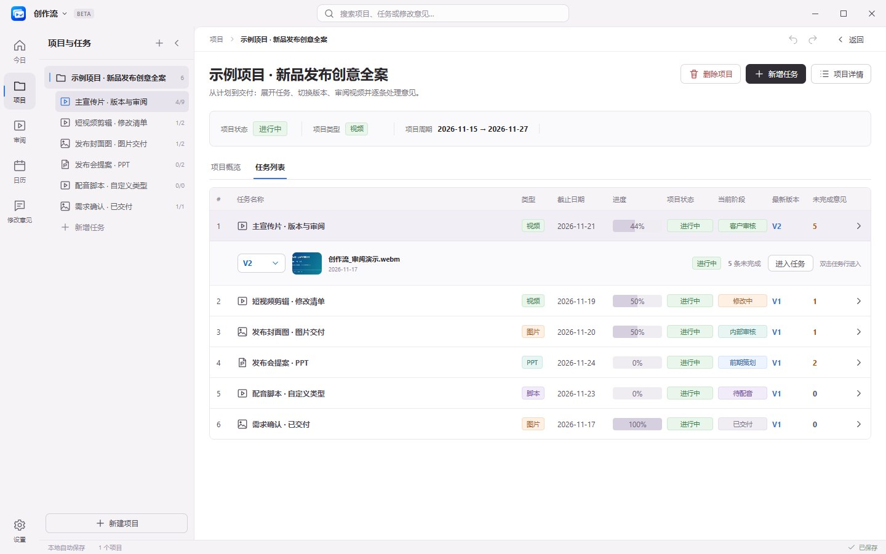
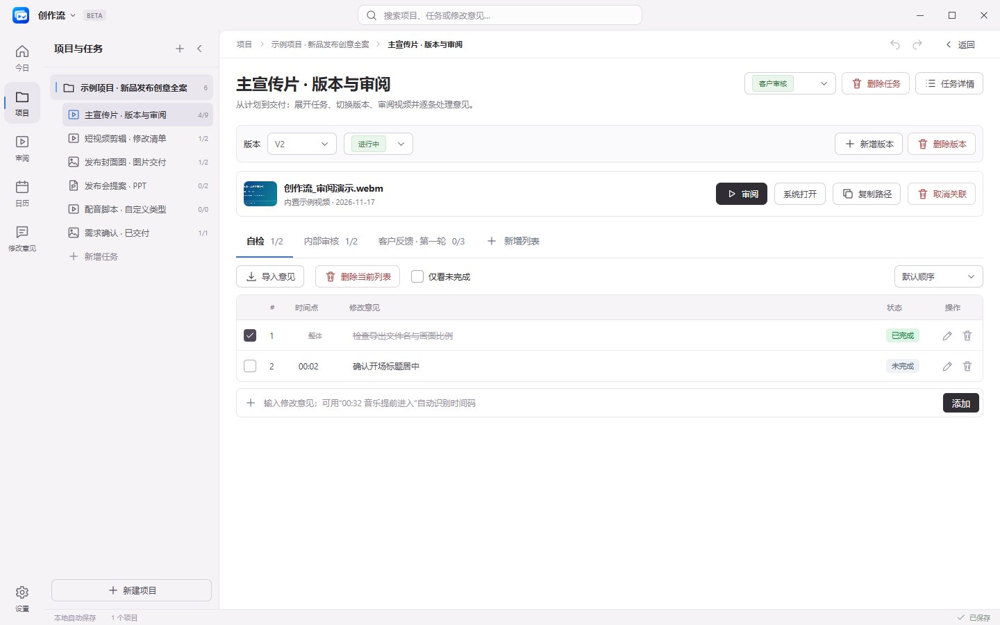

<div align="center">


# 创作流 · CreativeFlow

**把项目、版本和修改意见，接成一条清楚的创作流程。**

面向视频创作者的 Windows 桌面工作台，集中安排任务、审阅视频、跟进反馈。

[](https://github.com/Yanglizi1001/CreativeFlow/releases/tag/0.7.0-beta.3)
[](#下载安装)
[](#数据与备份)

**[下载 Windows 测试版](https://github.com/Yanglizi1001/CreativeFlow/releases/tag/0.7.0-beta.3)** · [更新记录](CHANGELOG.md) · [版本说明](docs/beta-0.7.0-beta.3.md) · [反馈问题](https://github.com/Yanglizi1001/CreativeFlow/issues)

</div>

一个项目有主片、短视频和封面，每项交付又有不同版本；自检、内部审核和客户反馈，也需要分开记录。创作流把这些工作放在同一个地方：从项目进入任务，从版本找到文件，再逐条处理修改意见。

以视频剪辑与审阅为核心，也兼顾项目中的封面、海报等平面交付。工作数据保存在本机，关联自己的素材即可开始使用。

## 先把项目和任务理清楚



主宣传片、短视频、封面图，可以放在同一个项目中管理。展开任务，先看文件与待处理情况；进入任务，再查看版本和修改清单。

- **进度集中查看**：任务阶段、截止日期、最新版本和未完成意见放在同一张列表里。
- **按自己的流程分类**：状态、类型和阶段支持自定义文字与颜色。
- **任务独立配色**：同一个任务在日历、甘特和小组件中使用一致的颜色。
- **需要时再看详情**：侧边目录可收起、拖拽调宽，详情按需打开，为主要内容留出空间。

## 每次交付，都留得住版本



**一个任务，多个版本；每个版本，独立的修改清单。** 为 V1、V2 关联各自的文件，按自检、内部审核、客户反馈整理意见，回看时就能找到对应内容。

- 默认展示最新版本，通过下拉菜单切换历史版本。
- 在任务面板或审阅界面直接新增版本，选择是否继承未完成意见。
- 修改意见支持编辑、逐条勾选、未完成筛选与排序，也可导入 TXT、Markdown、SRT 文本。
- 关联本地文件后，可在应用内审阅视频，或使用系统默认程序打开文件。

## 一边看片，一边把反馈记在画面上


看到需要调整的画面，记录当前时间的意见；点击时间码，就能回到对应位置。针对节奏、风格等全片反馈，选择 **「整体意见」**，无需指定时间。

| 审阅时想做的事 | 对应操作 |
| --- | --- |
| 标记某一处画面 | 在当前时间添加意见，时间线上显示标记 |
| 记录全片建议 | 添加整体意见，集中保留不绑定时间点的反馈 |
| 修改或删除反馈 | 点击正文编辑，右键选择操作；列表聚焦时可按 Delete 删除 |
| 连续处理问题 | 上一条／下一条未完成，配合倍速与局部循环 |
| 继续上次审阅 | 保留版本的播放位置，回到之前看到的地方 |

审阅意见与任务清单、修改意见中心和桌面小组件同步。编辑区提供保存与取消；有未提交内容时，切换前可选择保存、放弃或继续编辑。

## 把交付日期，展开成看得见的计划


设置开始日期与截止日期，在月历中查看连续任务条，或切换甘特图比较任务周期。不同任务用颜色区分，重叠安排更容易发现。

- **月、周、日与甘特**：按不同范围查看安排。
- **点击任务条**：打开详情，调整任务信息和颜色。
- **点击日期空白处**：查看当天涉及的项目与任务列表。
- **就地创建安排**：在计划界面新增项目或任务，按当前上下文填写日期。

## 待处理意见，放到桌面就能继续

<p align="center">
  
</p>

打开桌面小组件，查看计划或逐条处理修改意见，减少在工作窗口之间来回切换。

- **按项目与任务分组**：折叠暂时不看的内容，保留版本和清单来源。
- **双击直接编辑**：原位修改文字，保存后同步到主界面；复选框用于标记完成。
- **按需置顶**：右上角图钉控制是否位于普通窗口前方，重新打开和重启后记住选择。
- **草稿有去处**：保存、取消、切换和关闭有明确处理；其他窗口同时修改或删除时会提示。

打开方式：**标题栏「创作流 ▾」→ 显示桌面小组件**，也可以从设置中打开。

## 这些日常操作，也放在顺手的位置

跨项目的 **修改意见中心** 集中展示反馈，同时保留项目、任务、版本与清单信息，方便查找接下来需要处理的内容。

**Ctrl+Z 撤销、Ctrl+Shift+Z 重做**，主窗口与小组件共用本次运行的操作历史；文字编辑时优先处理输入框中的文字。播放、筛选和切换页面不占用撤销记录。

标题栏的软件名称下拉集中创建、备份、窗口与设置操作。最小化收至任务栏；点击关闭时，可以选择退出或隐藏到系统托盘，并记住选择。

## 下载安装

前往 **[0.7.0-beta.3 发布页](https://github.com/Yanglizi1001/CreativeFlow/releases/tag/0.7.0-beta.3)**，选择 Windows 64 位程序：

| 下载文件 | 使用方式 |
| --- | --- |
| [CreativeFlow-Setup-0.7.0-beta.3-win-x64.exe](https://github.com/Yanglizi1001/CreativeFlow/releases/download/0.7.0-beta.3/CreativeFlow-Setup-0.7.0-beta.3-win-x64.exe) | **安装版**，按提示安装，适合日常使用 |
| [CreativeFlow-0.7.0-beta.3-win-x64.exe](https://github.com/Yanglizi1001/CreativeFlow/releases/download/0.7.0-beta.3/CreativeFlow-0.7.0-beta.3-win-x64.exe) | **免安装版**，双击运行 |
| [SHA256SUMS.txt](https://github.com/Yanglizi1001/CreativeFlow/releases/download/0.7.0-beta.3/SHA256SUMS.txt) | 下载文件校验值 |

**更新**：先从系统托盘退出旧程序，再安装或打开新版。已有项目会继续保留，建议更新前在设置中导出备份。

**系统**：当前分发 Windows 11 x64 测试版。视频播放与素材编码有关，无法在应用内播放时，可使用系统播放器打开。

## 先用一个示例项目，走完一遍流程

首次使用提供 **一个完整示例项目**，包含六项任务、V1／V2 版本、18 秒演示视频、封面图片、自定义标签，以及整体和时间点修改意见。以上截图均来自 **0.7.0-beta.3 的内置示例**。

1. 展开项目，进入主宣传片任务，切换版本与修改清单。
2. 打开审阅，播放视频、定位反馈，添加一条时间点或整体意见。
3. 新增版本，试着继承未完成意见。
4. 查看日历与甘特排期，调整一个任务的颜色。
5. 打开小组件，双击编辑意见，观察主界面同步，再尝试撤销重做。

已有本地数据时，示例不会覆盖自己的项目。如需重新体验，先导出备份，再在设置中恢复示例数据。

<details>
<summary id="数据与备份"><b>数据保存在什么地方？换电脑怎么办？</b></summary>

项目、任务、版本、修改意见和颜色等工作记录保存在当前电脑，可在设置中导出、导入 JSON 备份。

**JSON 备份不包含关联的原始视频、图片等素材。** 换电脑时，请同时复制素材，并在需要时重新关联文件。

导入备份会替换当前工作数据，请先保留现有备份。分发包仅包含示例和演示素材，不包含开发者的个人项目。

当前版本用于本机个人工作，尚不包含局域网多人协作或云端同步。

</details>

<details>
<summary><b>快捷键与撤销范围</b></summary>

| 快捷键 | 功能 |
| --- | --- |
| Ctrl+Z | 撤销；输入框聚焦时优先撤销文字编辑 |
| Ctrl+Shift+Z | 重做 |
| Ctrl+Enter | 在审阅或小组件编辑区保存意见 |
| Esc | 取消编辑；有未保存内容时提示处理草稿 |
| Delete | 审阅列表条目聚焦时删除意见；输入框内用于删除文字 |
| Space | 审阅播放器播放／暂停，输入文字时不触发 |
| M | 审阅时添加修改意见，输入文字时不触发 |

工作数据历史最多保留本次运行的 50 次操作，并有容量上限；新修改会清空重做分支。重启程序、导入备份或恢复示例会清空历史。

</details>

<details>
<summary><b>从源码运行与打包</b></summary>

项目使用 **Electron、React 和 Vite**。建议使用 Node.js 22 与 pnpm 10。

```powershell
pnpm install --frozen-lockfile
pnpm dev
```

构建、测试与 Windows 打包：

```powershell
pnpm build
pnpm test
pnpm package:win
pnpm package:installer
```

前端开发服务由 `pnpm dev` 启动；桌面模式需先 `pnpm build`，再运行 `pnpm electron:dev`。窗口、托盘与本地文件能力在桌面模式中体验。

应用代码、图标与示例素材保留在仓库中；依赖、构建产物和个人工作数据不纳入版本管理。Windows 程序通过 Releases 分发。

</details>

## 一起把测试版打磨好

当前版本为 **0.7.0-beta.3**。欢迎反馈实际工作中遇到的问题，尤其是素材播放、文件路径、屏幕缩放、多显示器和窗口布局方面的体验。

提交时请附上软件版本、Windows 版本、复现步骤、预期与实际结果，以及必要的截图或录屏。可使用 [反馈模板](docs/testing-feedback.md)，也可以直接 [提交 Issue](https://github.com/Yanglizi1001/CreativeFlow/issues)。
