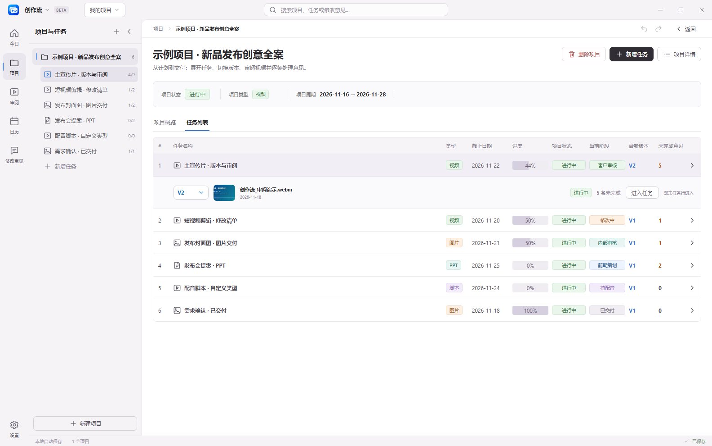
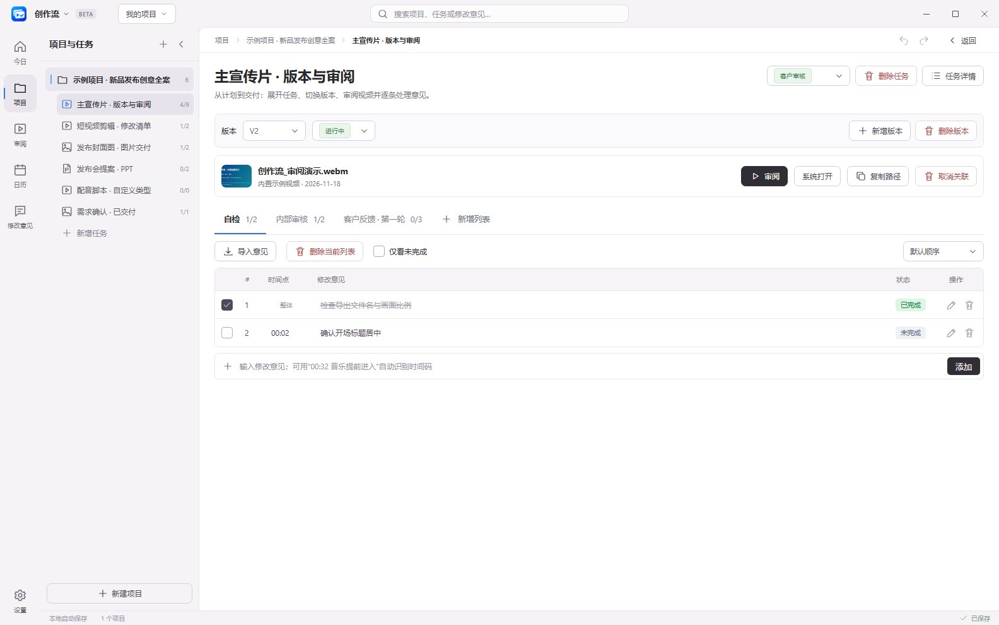
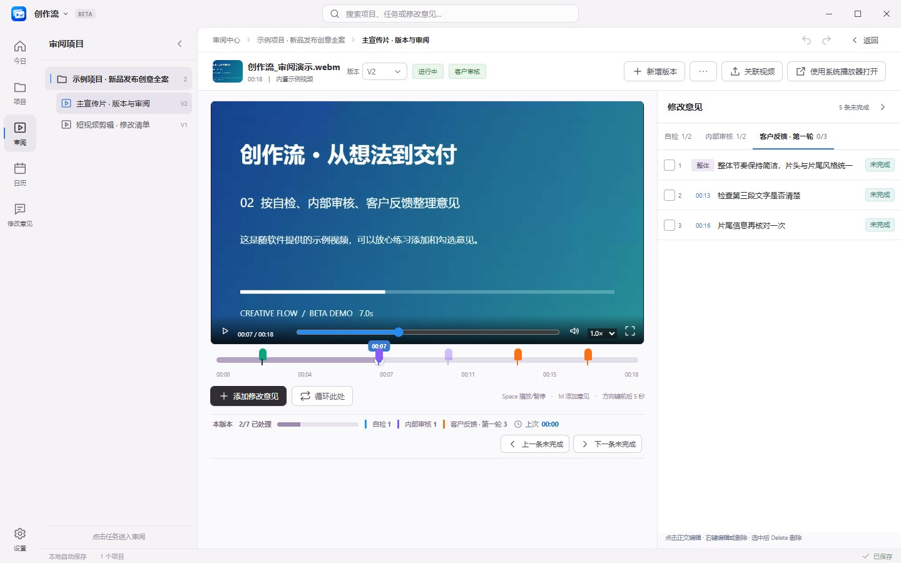
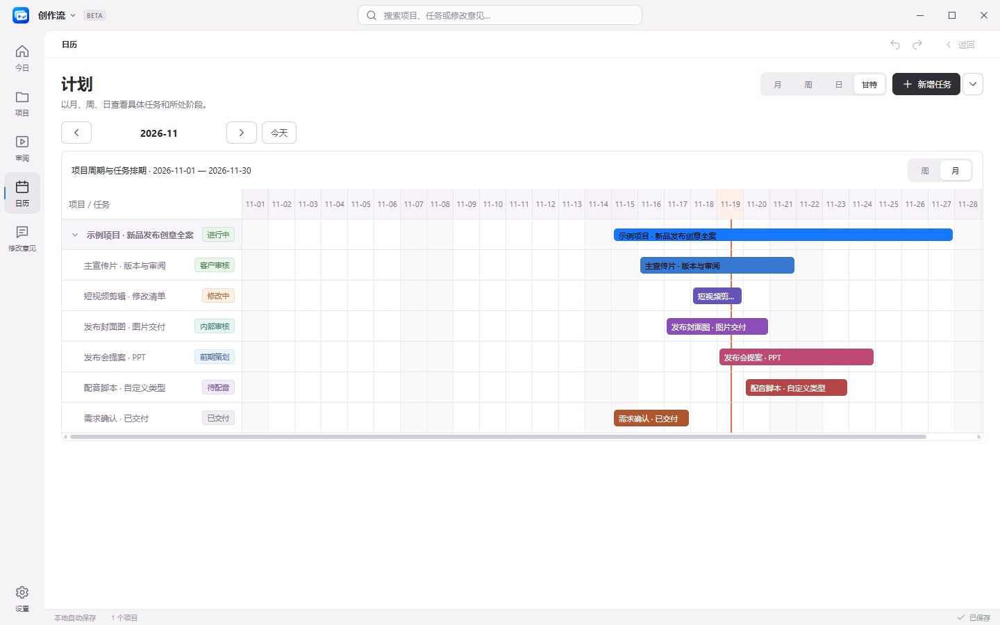
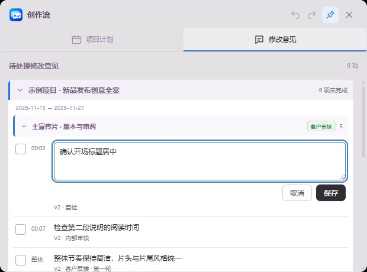

# 创作流 · CreativeFlow

**把项目版本、修改意见、排期和协作，放进同一个工作台。**

面向视频创作者的 Windows 桌面软件，帮助你理清交付任务、审阅视频、跟进反馈与安排创作计划。

**[下载安装版](https://github.com/Yanglizi1001/CreativeFlow/releases/download/0.7.1-beta/CreativeFlow-Setup-0.7.1-beta-win-x64.exe)** · [下载免安装版](https://github.com/Yanglizi1001/CreativeFlow/releases/download/0.7.1-beta/CreativeFlow-Portable-0.7.1-beta-win-x64.exe) · [全部下载](https://github.com/Yanglizi1001/CreativeFlow/releases/tag/0.7.1-beta) · [反馈问题](https://github.com/Yanglizi1001/CreativeFlow/issues)

一个项目有主宣传片、短视频和封面，每项交付又有不同版本；自检、内部审核和客户反馈，还需要分开记录。创作流把这些工作串起来：**从项目找到任务，从版本找到文件，再逐条处理修改意见。**

以本地项目管理和视频审阅为核心，兼顾图片、PPT、脚本等交付。打开软件选择「先使用本地项目」，关联自己的素材即可开始；需要团队配合时，可以进一步使用公司局域网协作。

> 本页复用仓库中已有的示例界面图片。项目、素材、意见及协作成员均为演示内容，不包含真实公司资料。

## 先把项目和任务理清楚

主宣传片、短视频、封面图、提案和配音脚本，可以放在同一个项目里管理。展开任务先看文件和待处理情况，进入任务再查看各个版本与修改清单。

- **项目有全貌**：集中查看任务类型、截止日期、当前阶段、最新版本和未完成意见。
- **任务各有进度**：项目进行中时，不同任务可以分别处于策划、拍摄、修改、审核或已交付阶段。
- **分类适应自己的流程**：自定义状态、交付类型、任务阶段及标签颜色。
- **说明与备注随手记录**：项目、任务各自保留说明、日期和工作备注。
- **主要内容留出空间**：侧边目录可收起、展开和拖拽调宽，详情按需打开。

## 每次交付，都留得住版本

**一个任务，多个版本；每个版本，独立的文件与修改意见。** 为 V1、V2 关联各自的文件，按自检、内部审核、客户反馈整理清单，回看时能找到对应内容。

- 默认查看最新版本，通过下拉菜单切换历史版本。
- 在任务详情或审阅页新增版本，建立空版本，或选择继承旧版本的未完成意见。
- 为视频、图片、PPT 等交付关联本地文件；视频可进入内置审阅，也可用系统默认程序打开关联文件。
- 不同版本分别保留完成状态、意见列表和审阅位置，避免把两轮反馈混在一起。

**0.7.1 beta 补齐版本删除与回收站：**

任务详情点击「删除版本」，审阅页或审阅中心预览选择「版本操作 → 删除当前版本」。确认前会显示意见总数与未完成数量，本地原文件保留。

删除当前版本后切换到最新的剩余版本；删除最后一个版本，任务与日历排期继续保留。默认版本编号继续递增，例如删除 V3 后，下次建立 V4。本地版本可从「版本回收站」恢复，回收站在重启后仍保留，也支持本次运行中的撤销。

## 一边看片，一边把反馈记在画面上

看到需要调整的画面，记录当前时间的意见；点击时间码，就能回到对应位置。针对节奏、风格等全片建议，选择 **「整体意见」**，无需绑定时间点。

| 审阅时想做的事 | 对应操作 |
| --- | --- |
| 标记某一处画面 | 添加时间点意见，在时间线上显示标记 |
| 记录全片建议 | 添加整体意见，集中保留不绑定时间点的反馈 |
| 修改或删除意见 | 点击正文编辑，右键选择操作；条目聚焦时按 Delete 删除 |
| 连续检查问题 | 上一条／下一条未完成，配合倍速、前后定位和局部循环 |
| 继续上次审阅 | 保留版本播放位置，回到之前看到的地方 |
| 集中查看待审版本 | 在审阅中心按项目、阶段、关键词和未完成意见筛选 |

审阅意见与任务清单、修改意见中心和桌面小组件使用同一套数据。编辑区提供保存与取消；切换页面、版本或关闭编辑区前，可选择保存、放弃或继续编辑未提交内容。

## 修改意见，从记录到完成都在一起

反馈多了以后，可以按来源建立多个清单，例如「自检」「内部审核」「客户第一轮反馈」。每条意见保留正文、完成状态及可选时间码。

- **逐条跟进**：编辑、勾选完成、筛选未完成意见，并按需要排序。
- **集中处理**：修改意见中心跨项目查看反馈，同时保留项目、任务、版本和清单来源。
- **接收外部反馈**：导入 TXT、Markdown、SRT 文本整理修改意见。
- **带到下一轮**：新增版本时选择继承未完成意见，新旧版本分别维护。
- **减少误操作**：删除与编辑配合撤销重做，未保存文字有草稿保护。

## 把交付日期，展开成看得见的计划

设置开始日期与截止日期，在月历中查看连续任务条，或切换甘特图比较工作周期。不同任务以颜色区分，重叠安排更容易发现。

- **月、周、日与甘特**：按不同范围查看安排。
- **点击任务条**：打开详情，修改日期、阶段和颜色。
- **点击日期空白处**：查看当天涉及的项目与任务。
- **就地新建安排**：在计划界面创建项目或任务，按上下文填写日期。
- **任务配色一致**：同一任务在项目、日历、甘特和小组件中保持自己的颜色。

## 待处理意见，放到桌面就能继续

打开小组件查看计划或逐条处理意见，减少在工作窗口之间来回切换。

- **计划和反馈随时查看**：按项目与任务分组，折叠暂时不看的内容。
- **双击直接编辑**：原位修改意见，保存后同步到主界面，复选框用于标记完成。
- **保留上下文**：显示版本、清单和时间点，知道这条反馈属于哪次交付。
- **按需置顶**：右上角图钉控制置顶，重新打开和重启后记住选择。
- **编辑过程有保护**：保存、取消、切换与关闭有明确处理，其他窗口同时修改或删除时会提示。

打开方式：**标题栏「创作流 ▾ → 显示桌面小组件」**，也可以从设置中打开。

## 这些日常操作，也放在顺手的位置

标题栏的软件名称下拉集中创建、备份、窗口和设置操作。最小化收至任务栏；点击关闭时，可选择退出或隐藏到系统托盘，并记住选择。

**Ctrl+Z 撤销、Ctrl+Shift+Z 重做**，主窗口与小组件共用本次运行的常规工作历史。输入文字时优先处理输入框的文字，播放、筛选和切换页面不占用工作撤销记录。

| 快捷键 | 功能 |
| --- | --- |
| Ctrl+Z / Ctrl+Shift+Z | 撤销／重做工作修改 |
| Ctrl+Enter | 在审阅或小组件编辑区保存意见 |
| Esc | 取消编辑或先处理未保存草稿 |
| Delete | 删除聚焦的意见，输入框中用于删除文字 |
| Space | 播放／暂停，输入文字时不触发 |
| M | 审阅时添加意见，输入文字时不触发 |

常规工作历史最多保留本次运行的 50 次操作，并有容量上限；新修改清空重做分支。重启、导入备份或恢复示例会清空历史。本地版本回收站独立保留，重启后仍可恢复版本。

## 数据与备份

「我的项目」中的项目、任务、版本、意见、日期、颜色和文件关联记录保存在当前电脑，可在设置中导出、导入 JSON 备份。

**JSON 备份不包含关联的原始视频、图片等素材。** 换电脑时，请同时复制素材，必要时重新关联文件。导入备份会替换当前工作数据，操作前先保留现有备份。

## 先用一个示例项目，走完一遍流程

首次使用提供一个完整的 **「示例项目 · 新品发布创意全案」**：六项任务、V1/V2、18 秒内置演示视频、封面、自定义标签，以及整体和时间点意见。

1. 展开项目，进入主宣传片任务，切换版本和修改清单。
2. 打开审阅，播放示例视频，定位反馈，添加时间点或整体意见。
3. 新增版本，尝试继承未完成意见，再体验删除与回收站恢复。
4. 查看日历和甘特排期，调整一个任务的日期与颜色。
5. 打开小组件，双击编辑意见，观察主界面同步，再尝试撤销重做。
6. 导出一份本地备份，开始建立自己的项目。

已有本地资料时，示例不会覆盖自己的项目。如需重新体验，先导出备份，再在设置中恢复示例数据。

## 扩展：需要时，再加入公司局域网协作

团队需要共同审阅时，可以在同一个客户端切换到公司空间，继续使用熟悉的项目、版本、意见、日历和小组件界面。

- 上传本地项目的资料与排期，保留本地原项目；确认发布视频后供同事访问。
- 每个视频版本分别设置仅查看、可批注、可编辑或可管理权限。
- 意见、完成状态、排期与小组件同步；离线修改保存在本机，重连后同步，同字段冲突核对后处理。
- 协作版本支持删除与回收站恢复，主机确认权限与操作结果；视频播放、发布、权限管理及版本删除／恢复需要连接主机。

管理员提供公司接入文件与一次性邀请码，员工在应用内核对主机、确认信任后加入；个人工作时切回「我的项目」。详细步骤见 [部署与使用说明](docs/manuals/0.7.1-beta-部署与使用说明.md)。

### 协作管理器：集中维护公司的主机

协作管理器供服务器管理员安装、升级和维护主机，提供安装版与免安装版，内含主机服务和独立运行环境。主机电脑也可以运行客户端参与创作与审阅。

管理器集中处理邀请码、管理员与成员、设备接入、网络检测和公司接入文件；支持自定义存储位置、备份恢复、迁移，以及卸载时选择是否保留数据。

服务开机启动与管理器登录自启分别设置。空间容量上限和最低磁盘余量可调整，容量不足时限制新增视频上传，保留已有资料。操作步骤见 [协作管理器说明](docs/manuals/协作主机管理器-使用说明.md)。

## 下载安装

当前版本为 **0.7.1 beta · Windows x64**，已在 Windows 11 验证。个人使用下载桌面软件即可；团队需要时再部署协作主机。

| 桌面软件 | 使用方式 |
| --- | --- |
| [安装版](https://github.com/Yanglizi1001/CreativeFlow/releases/download/0.7.1-beta/CreativeFlow-Setup-0.7.1-beta-win-x64.exe) | 按提示安装，适合日常使用 |
| [免安装版](https://github.com/Yanglizi1001/CreativeFlow/releases/download/0.7.1-beta/CreativeFlow-Portable-0.7.1-beta-win-x64.exe) | 放在固定文件夹中运行 |

更新前，从系统托盘完全退出旧程序和小组件，建议先导出本地备份。已有项目继续保留。视频能否播放与素材编码有关，无法在应用内播放时可使用系统播放器打开。

<b>团队部署与完整下载</b>

- [完整包](https://github.com/Yanglizi1001/CreativeFlow/releases/download/0.7.1-beta/CreativeFlow-Full-0.7.1-beta-win-x64.zip)：桌面软件、协作管理器各含安装版与免安装版，附带主机运行环境、维护工具和说明书。
- [协作管理器安装版](https://github.com/Yanglizi1001/CreativeFlow/releases/download/0.7.1-beta/CreativeFlow-HostManager-Setup-0.7.1-beta-win-x64.exe) · [协作管理器免安装版](https://github.com/Yanglizi1001/CreativeFlow/releases/download/0.7.1-beta/CreativeFlow-HostManager-Portable-0.7.1-beta-win-x64.exe)，运行时需要管理员授权。
- [SHA256SUMS.txt](https://github.com/Yanglizi1001/CreativeFlow/releases/download/0.7.1-beta/SHA256SUMS.txt)：下载文件校验值。

已有公司空间先更新管理器，执行「设置与维护 → 升级现有主机」，沿用原程序与数据目录并自动备份，再更新员工客户端。原公司空间、成员和视频继续保留，已有视频无需重新上传。

## 使用说明与更新记录

- [版本管理与升级说明](docs/manuals/0.7.1-beta-版本管理更新说明.md)
- [部署与使用说明](docs/manuals/0.7.1-beta-部署与使用说明.md) · [PDF](docs/manuals/pdf/Deployment-Guide.pdf)
- [协作管理器说明](docs/manuals/协作主机管理器-使用说明.md) · [PDF](docs/manuals/pdf/HostManager-Guide.pdf)
- [0.7.1 beta 更新记录](docs/releases/0.7.1-beta.md) · [历史更新](CHANGELOG.md) · [验收范围](docs/releases/0.7.1-beta-validation.md)

<b>从源码运行与打包</b>

本地桌面应用使用 Electron、React 和 Vite。准备 Node.js 24 与 pnpm 10：

~~~powershell
pnpm install --frozen-lockfile
node node_modules/electron/install.js
pnpm build
pnpm electron:dev
~~~

运行本地数据与同步检查：

~~~powershell
pnpm test
~~~

完整构建协作主机与四个 Windows 程序还需要 .NET 8 SDK：

~~~powershell
dotnet restore collaboration-dev/tests/CreativeFlow.Host.Tests/CreativeFlow.Host.Tests.csproj -r win-x64
dotnet test collaboration-dev/tests/CreativeFlow.Host.Tests/CreativeFlow.Host.Tests.csproj -r win-x64 --no-restore
pnpm package:build-only
~~~

构建输出由 config/project-layout.json 配置，程序通过 Releases 分发。依赖、构建产物和个人资料不纳入源码仓库。本地界面验收与自动测试范围见上方验收说明。

欢迎通过 [Issues](https://github.com/Yanglizi1001/CreativeFlow/issues) 反馈版本、Windows 环境、复现步骤和截图。[0.7.0 beta3](https://github.com/Yanglizi1001/CreativeFlow/releases/tag/0.7.0-beta.3) 保留用于追溯。
