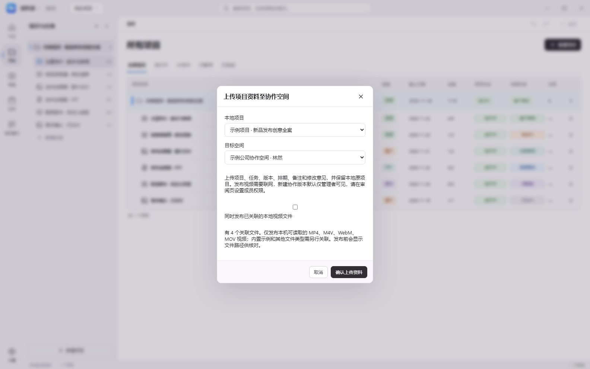
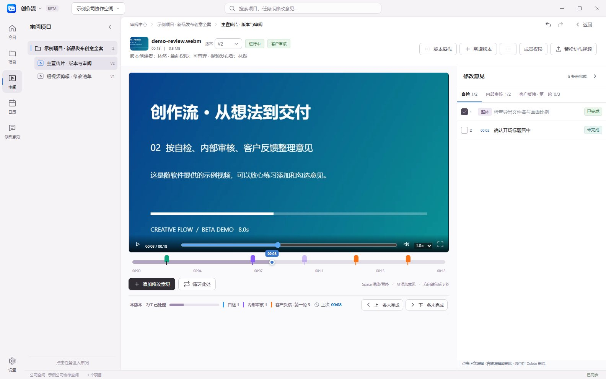
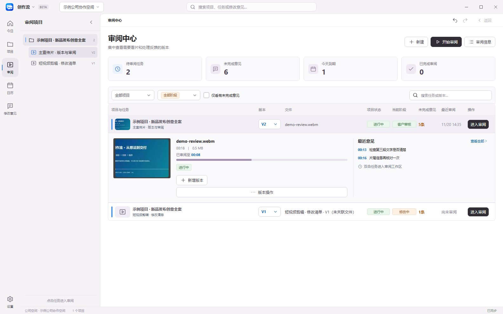
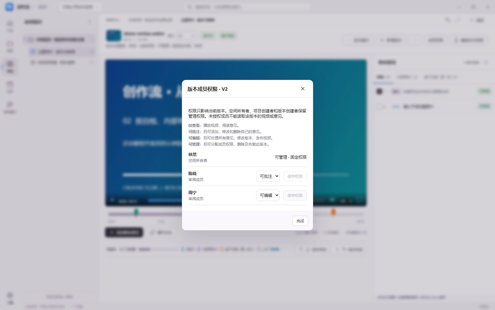
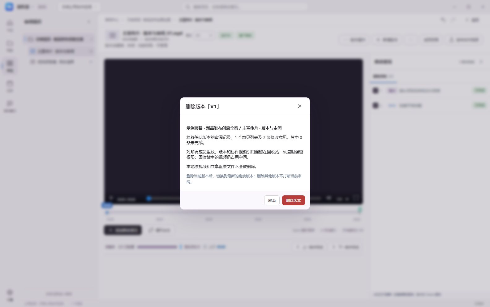
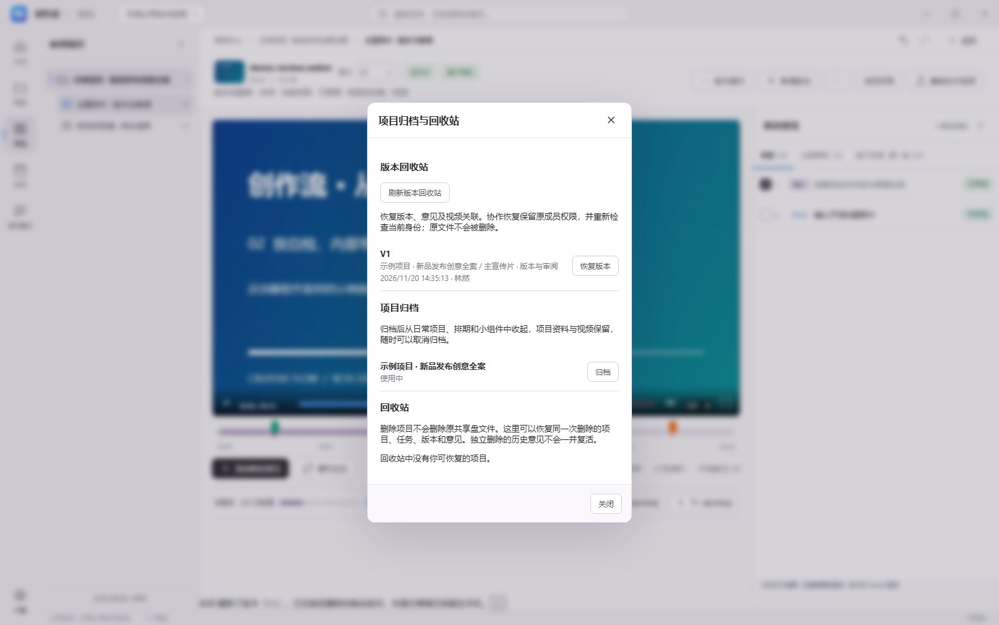
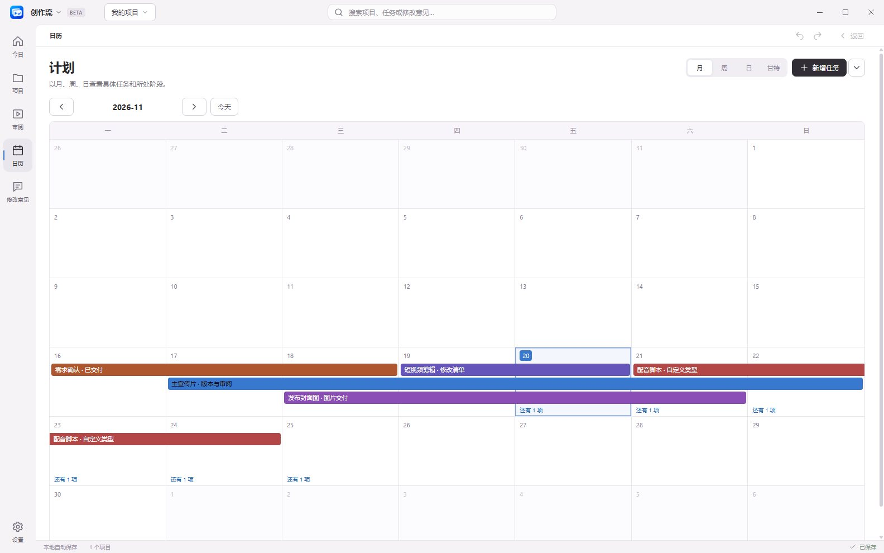
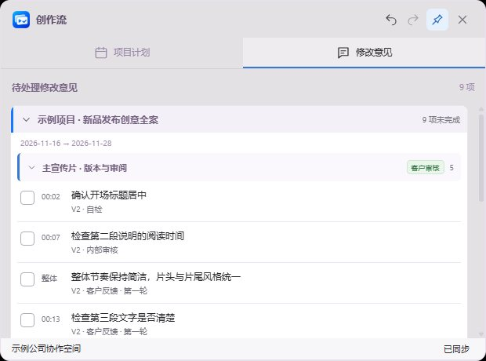
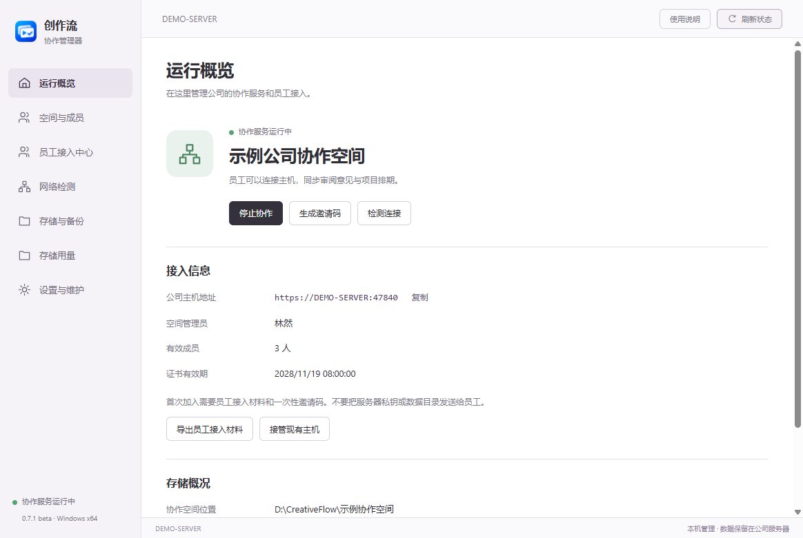
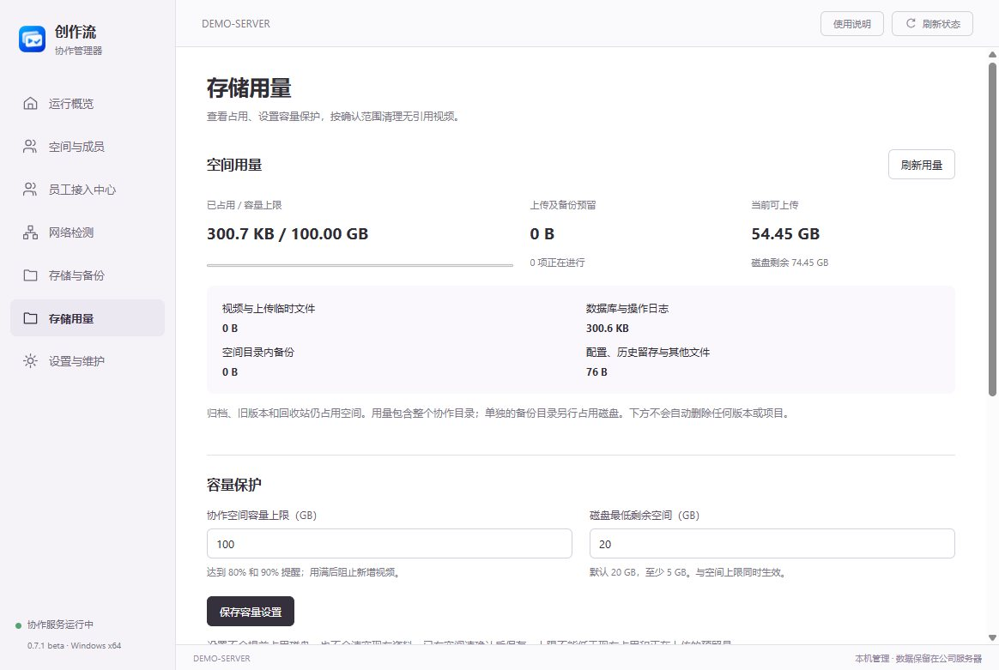

# 创作流 · CreativeFlow

**从本地创作，到公司局域网共同审阅。**

面向视频创作者的 Windows 桌面工作台，把项目、版本、修改意见、排期和团队协作放在一起。

**[下载完整软件包](https://github.com/Yanglizi1001/CreativeFlow/releases/tag/0.7.1-beta)** · [版本更新](docs/releases/0.7.1-beta.md) · [部署与使用](docs/manuals/0.7.1-beta-部署与使用说明.md) · [反馈问题](https://github.com/Yanglizi1001/CreativeFlow/issues)

0.7.1 beta 在原本地版的界面中加入局域网协作：继续管理自己的项目，也可以上传项目资料，让同事按视频版本权限共同看片、批注和处理意见。服务器也可以同时运行客户端参与协作。

本次补齐了**版本删除与回收站**，以及协作视频缩略图、成员权限、离线同步、小组件联动、主机管理和容量保护。

> 全部图片使用内置「示例项目 · 新品发布创意全案」及独立的「示例公司协作空间」。人名、主机地址、存储位置和管理器状态用于演示，不包含真实公司资料。

## 下载安装

前往 **[0.7.1 beta 发布页](https://github.com/Yanglizi1001/CreativeFlow/releases/tag/0.7.1-beta)**。客户端与协作管理器均提供安装版、免安装版：

| 下载内容 | 适合谁 |
| --- | --- |
| [完整软件包](https://github.com/Yanglizi1001/CreativeFlow/releases/download/0.7.1-beta/CreativeFlow-Full-0.7.1-beta-win-x64.zip) | 首次部署或整套更新；含四个程序、主机运行环境、离线维护工具和说明书 |
| [客户端安装版](https://github.com/Yanglizi1001/CreativeFlow/releases/download/0.7.1-beta/CreativeFlow-Setup-0.7.1-beta-win-x64.exe) | 员工日常使用，也可独立管理本地项目 |
| [客户端免安装版](https://github.com/Yanglizi1001/CreativeFlow/releases/download/0.7.1-beta/CreativeFlow-Portable-0.7.1-beta-win-x64.exe) | 放在固定文件夹中运行 |
| [协作管理器安装版](https://github.com/Yanglizi1001/CreativeFlow/releases/download/0.7.1-beta/CreativeFlow-HostManager-Setup-0.7.1-beta-win-x64.exe) | 服务器管理员部署、升级与维护公司空间 |
| [协作管理器免安装版](https://github.com/Yanglizi1001/CreativeFlow/releases/download/0.7.1-beta/CreativeFlow-HostManager-Portable-0.7.1-beta-win-x64.exe) | 不安装管理器，同样内含主机服务与运行环境；需要管理员授权 |
| [SHA256SUMS.txt](https://github.com/Yanglizi1001/CreativeFlow/releases/download/0.7.1-beta/SHA256SUMS.txt) | 核对文件完整性 |

**已有公司空间：先更新管理器，执行「设置与维护 → 升级现有主机」，再更新员工客户端。** 沿用原程序与数据目录，升级前自动备份。原公司空间、成员和视频继续保留，已有视频无需重新上传。仅本地用户只需更新客户端。

更新客户端前，从系统托盘完全退出旧程序及小组件。当前为 Windows x64 测试版，已在 Windows 11 验证；不同电脑的视频编码、路径、缩放及多显示器体验仍欢迎反馈。

## 本地项目，继续按熟悉的方式工作

一个项目可以同时包含主宣传片、短视频、封面、提案和脚本；每个任务有自己的版本和修改清单。

- 展开任务看文件与反馈，进入任务切换 V1、V2，分别记录自检、内部审核和客户意见。
- 视频与图片继续关联本地文件；状态、类型、阶段和颜色支持自定义。
- 原本地项目始终保留，加入公司空间不会自动上传或替换个人资料。

## 本地项目，可以上传到公司空间

应用菜单 **「上传本地项目资料」** 可以上传项目、任务、版本、排期、备注和修改意见，并保留本地原项目。

本机可读取的关联视频可另行确认发布到主机。内置示例视频及非视频交付文件不直接当作共享文件；图片、PPT、脚本等任务仍可共享排期与意见，原文件继续在本地关联。

## 多个人看片，反馈落在同一个版本上

发布视频后，同事按权限进入同一个版本审阅。时间点意见可以定位画面，整体意见用于节奏、风格等全片反馈。

- **一起处理意见**：批注、完成状态和修改结果同步到审阅、任务清单、修改意见中心与小组件。
- **版本各自独立**：新增版本可继承未完成意见，替换视频保留当前版本的意见。
- **缩略图随视频更新**：发布、替换及重启后显示协作视频缩略图，审阅中心先看预览再进入看片。
- **播放进度各自保留**：继续上次审阅，播放和筛选不成为其他成员的工作修改。
- **身份清楚可查**：版本显示创建者、视频发布者和当前权限，工作修改记录操作来源。

## 每个视频版本，分别设置成员权限

| 权限 | 可以做什么 |
| --- | --- |
| 不可见 | 无法读取该版本的视频与意见 |
| 仅查看 | 播放视频、阅读意见 |
| 可批注 | 另可添加、修改和删除自己的意见 |
| 可编辑 | 另可处理全部意见、修改版本和发布视频 |
| 可管理 | 另可分配成员权限、删除及恢复版本 |

空间所有者、项目创建者和版本创建者保留对应管理权限。上传者身份本身不额外授予删除权。读取视频、保存修改和管理版本均由主机检查权限；撤销访问后已打开的审阅也会更新。

## 删除版本与恢复，审阅时就能完成

审阅页与审阅中心预览提供 **「版本操作 → 删除当前版本」**；任务详情保留「删除版本」。三个入口使用同一个确认窗口。

- 删除前显示意见数量、未完成数量和影响范围；期间有新意见时，重新核对再确认。
- 本地删除进入持久回收站，可恢复，也支持当次撤销。
- 协作删除须联网且拥有「可管理」权限，主机确认后才显示成功，不排入离线队列。
- 删除当前版本后切换到最新的剩余版本；最后一个版本删除后，仍保留任务和日历排期。
- 版本编号继续递增，例如删除 V3 后，下次默认建立 V4。

**「版本回收站」** 可以恢复版本、视频关联、同次删除的意见和原权限。恢复时重新检查当前身份；所属项目或任务已删除时须先恢复父级。

本地原视频与共享盘文件不会随版本删除。协作视频在回收站中仍占容量并受清理保护。其他成员正在看的版本被删除时，会停止播放并提示删除人，未提交草稿保留本机。

## 排期、离线修改和小组件保持一致

月、周、日和甘特视图管理同一套任务日期，任务颜色在项目、日历与小组件中一致。公司空间的排期由主机保存并同步给成员。

离线时，允许离线编辑的资料和意见保存在本机，重启后继续保留。重连后同步；同一字段被多人修改时展示对比，再选择处理结果。**视频播放、发布、权限管理及协作版本删除／恢复需要连接主机。**

小组件跟随主窗口切换本地或公司空间。双击意见编辑、标记完成、折叠分组和切换置顶，保存、取消及草稿保护使用一致的交互。

## 用协作管理器部署和维护主机

- 安装、升级主机，自定义服务器程序和协作空间位置；主机与员工客户端可在同一台电脑运行。
- 生成、重置一次性邀请码，修改管理员和成员名称，管理成员及设备。
- 导出公司接入文件，检查网络、端口、服务与证书状态。
- 备份、恢复、路径迁移；卸载服务时选择是否保留数据。
- 分别设置服务开机启动、管理员登录后打开管理器；关闭管理器窗口不停止后台服务。

新空间默认容量上限 **100 GB**、最低磁盘余量 **20 GB**，可在「存储用量」调整。接近上限时提示，容量不足时限制新增视频上传，不自动删除已有资料。仅无版本或回收站引用的视频可以进入清理范围。

## 加入公司协作空间

1. 管理员部署主机，导出 **.cfspace 公司接入文件**，为每位成员单独生成邀请码。
2. 员工打开客户端加入公司空间，导入接入文件，核对公司名称、主机地址与证书指纹。
3. 在应用内确认信任，填写姓名和六位邀请码加入，无需手工安装 Windows 根证书。
4. 管理者为视频版本分配权限，成员共同审阅；个人工作时切回「我的项目」。

邀请码单次使用、10 分钟有效，没有固定默认码。主机需保持开机，员工电脑须能与主机在公司网络中互通。

## 使用说明与示例

- [版本管理更新与升级步骤](docs/manuals/0.7.1-beta-版本管理更新说明.md)
- [部署与使用说明](docs/manuals/0.7.1-beta-部署与使用说明.md) · [PDF](docs/manuals/pdf/Deployment-Guide.pdf)
- [协作管理器说明](docs/manuals/协作主机管理器-使用说明.md) · [PDF](docs/manuals/pdf/HostManager-Guide.pdf)
- [0.7.1 beta 更新记录](docs/releases/0.7.1-beta.md) · [验收范围](docs/releases/0.7.1-beta-validation.md) · [历史更新](CHANGELOG.md)

首次使用提供一个完整示例项目：六项任务、V1/V2、18 秒演示视频、封面、整体意见与时间点意见。已有资料不会被覆盖；重新体验示例前，请先导出自己的备份。

<b>数据、备份与撤销</b>

「我的项目」保存在当前电脑，可导出、导入 JSON 备份；JSON 不包含原始视频与图片，换电脑时须另外复制素材。公司空间以主机资料为准，完整备份由管理器完成，个人 JSON 不用于覆盖公司空间。

Ctrl+Z／Ctrl+Shift+Z 撤销重做，输入文字时优先处理文字。常规工作历史保留本次运行最多 50 次操作并有容量上限；协作冲突、恢复和权限以主机校验为准。删除版本可从回收站恢复，本地回收站重启后继续保留。

Space 播放／暂停，M 添加意见，Ctrl+Enter 保存意见，Esc 处理编辑，Delete 删除聚焦意见。切换前保护未保存内容。

<b>从源码运行与打包</b>

客户端和管理器使用 Electron、React、Vite，主机使用 .NET 8。准备 Node.js 24、pnpm 10 和 .NET 8 SDK：

~~~powershell
pnpm install --frozen-lockfile
node node_modules/electron/install.js
pnpm build
pnpm electron:dev
~~~

~~~powershell
pnpm test
dotnet restore collaboration-dev/tests/CreativeFlow.Host.Tests/CreativeFlow.Host.Tests.csproj -r win-x64
dotnet test collaboration-dev/tests/CreativeFlow.Host.Tests/CreativeFlow.Host.Tests.csproj -r win-x64 --no-restore
pnpm package:build-only
~~~

config/project-layout.json 记录批次及输出路径。GitHub Actions 构建四个程序，通过 Releases 分发完整包、独立下载和 SHA-256。依赖、构建产物和个人资料不提交到源码仓库。

本地已通过 44 项数据／同步检查、41 项服务端检查，并验证真实打包客户端的本地及双用户版本管理、多人审阅、离线冲突、小组件和容量保护。GitHub 发布流程重新运行自动测试，本地界面验收与 CI 记录分开说明。

欢迎通过 [Issues](https://github.com/Yanglizi1001/CreativeFlow/issues) 反馈版本、Windows 环境、复现步骤和截图。[0.7.0 beta3](https://github.com/Yanglizi1001/CreativeFlow/releases/tag/0.7.0-beta.3) 保留用于追溯。

