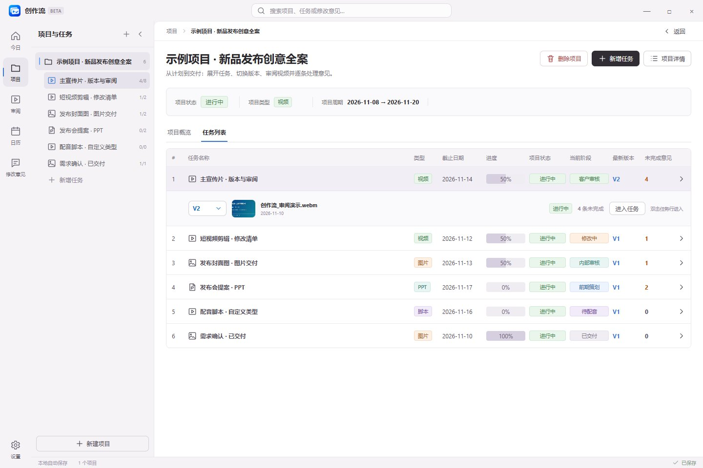
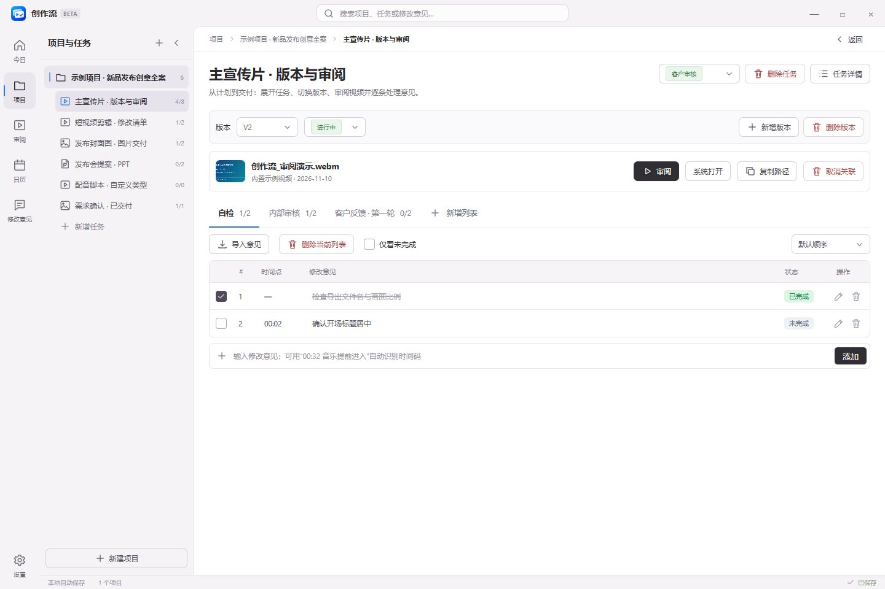
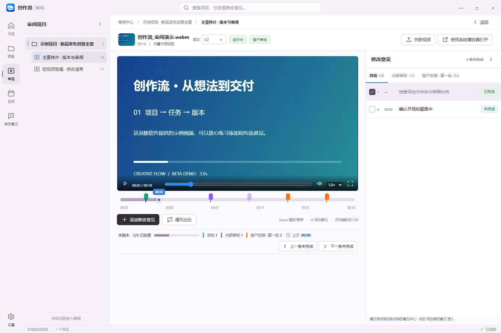
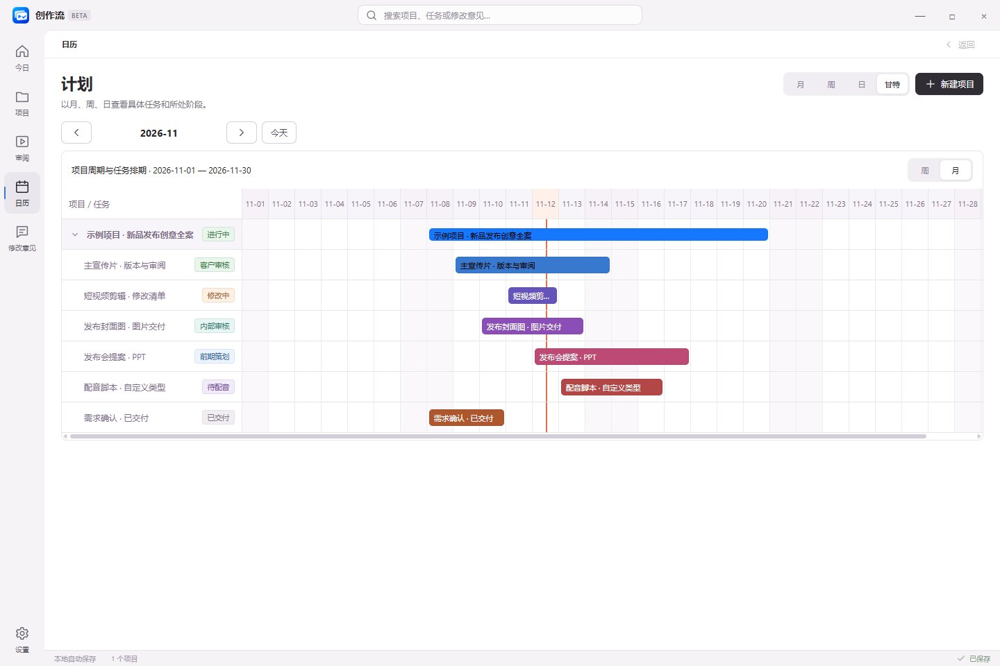

<p align="center">
  
</p>

<h1 align="center">创作流 · CreativeFlow</h1>

<p align="center">
  面向视频创作者的个人项目、计划与审阅工作台
</p>

<p align="center">
  Windows 11 · 64 位 · 0.7.0-beta.2
</p>

<p align="center">
  <a href="https://github.com/Yanglizi1001/CreativeFlow/releases/tag/0.7.0-beta.2">下载测试版</a>
  ·
  <a href="docs/beta-0.7.0-beta.2.md">版本说明</a>
  ·
  <a href="https://github.com/Yanglizi1001/CreativeFlow/issues">反馈问题</a>
</p>

---

## 从项目安排到逐条修改

剪辑工作不止发生在时间线上。项目排期、文件迭代、自检记录和客户反馈，同样需要有序管理。

创作流将这些工作集中在一个本地工作台中：按项目组织任务，为任务保留不同版本，再将每个版本的修改意见整理成可逐条处理的清单。查看计划、打开视频、定位反馈和勾选完成，可以衔接进行。

以视频剪辑与审阅为核心，也兼顾项目中的海报等平面交付任务。

## 工作界面

以下截图来自 **0.7.0-beta.2** 的内置示例项目。

### 项目与任务

在一个项目中组织多个交付任务，查看时间安排、当前阶段、最新版本和未完成意见。单击任务展开预览，双击进入任务工作区。



### 版本与修改清单

每个任务可以保留多个版本，每个版本独立整理修改意见。自检、内部审核、客户反馈等清单按需创建，意见直接展开，方便逐条修改与勾选。



### 视频审阅

播放视频时直接添加带时间码的意见，点击意见即可定位画面；处理结果同步到任务清单与修改意见中心。



### 日历与甘特计划

按任务起止日期查看安排，以独立颜色区分任务，直观看到工作周期与重叠情况。



## 核心功能

### 项目与任务管理

- 在一个项目中管理多个视频及相关交付任务。
- 记录项目说明、备注、开始日期和截止日期。
- 为任务设置创作阶段，区分策划、拍摄、制作、修改与审核。
- 自定义状态、类型和阶段标签，并调整标签颜色。
- 为每个任务设置独立颜色，在日历、甘特图和桌面小组件中保持一致。

### 版本与修改清单

- 为任务建立多个版本，分别关联本地交付文件。
- 默认查看最新版本，通过下拉菜单切换历史版本。
- 按自检、内部审核、客户反馈等来源建立修改清单。
- 在列表中直接查看、编辑和逐条勾选意见，完成后划线标记。
- 支持时间码、未完成筛选、排序，以及 TXT、Markdown、SRT 文本导入。
- 创建新版本时，可继承上一版本的未完成意见。

### 视频审阅

- 在应用内播放关联的视频，在当前播放时间添加意见。
- 在时间线上显示意见标记，点击带时间码的意见跳转到对应位置。
- 支持倍速播放、局部循环和播放位置记忆。
- 使用“上一条 / 下一条未完成”连续处理反馈。
- 审阅意见与任务工作区、修改意见中心和桌面小组件同步。

需要时，也可以使用系统默认程序打开关联文件。

### 日历与甘特计划

- 通过月、周、日视图查看计划。
- 根据开始日期与截止日期显示连续任务条。
- 通过甘特视图查看任务周期与时间安排。
- 点击任务条查看详情、调整信息和任务颜色。
- 点击日期空白处，查看当天涉及的项目与任务。

### 跨项目修改意见中心

集中查找不同项目中的待处理反馈，并保留所属项目、任务和版本信息。无需逐个打开项目，就能找到需要继续处理的修改意见。

### 桌面小组件

将常用信息留在桌面，减少来回切换窗口。

| 项目计划 | 修改意见 |
| --- | --- |
| 按月、周、日查看计划范围内的任务 | 按项目与任务分组查看待处理意见 |
| 显示任务状态与当前阶段 | 直接勾选已完成的意见 |
| 与主窗口数据同步 | 与审阅和任务清单同步 |

### 窗口与布局

- 项目目录与审阅目录支持收起、展开和拖拽调整宽度。
- 详情面板按需打开，为主要工作区留出空间。
- 路径导航与返回按钮配合使用，方便在项目、任务和审阅之间切换。
- 最小化按钮将窗口收至任务栏。
- 关闭窗口时可选择退出或隐藏到系统托盘，并可记住选择；设置中可随时调整。

## 下载与开始使用

前往 [Releases 页面](https://github.com/Yanglizi1001/CreativeFlow/releases) 下载 Windows 64 位程序：

| 文件 | 使用方式 |
| --- | --- |
| `CreativeFlow-Setup-0.7.0-beta.2-win-x64.exe` | 安装版，适合日常使用 |
| `CreativeFlow-0.7.0-beta.2-win-x64.exe` | 免安装版，直接运行 |

首次启动提供 **一个完整示例项目**，包含六个任务、演示视频、文件版本及多来源修改清单，可以直接体验主要功能。

建议按以下顺序了解软件：

1. 在“项目”中查看示例项目与任务。
2. 打开任务，切换版本并查看修改清单。
3. 进入“审阅”，体验视频播放与时间码意见。
4. 在“日历”中查看计划与任务周期。
5. 打开桌面小组件，查看计划和待处理反馈。

已有本地数据时，更新程序不会自动用示例项目覆盖。若希望重新体验示例，可先导出备份，再在设置中恢复示例数据。

本机已有创作流运行时，请先从系统托盘退出旧程序，再启动新版本。

## 数据与备份

创作流将工作数据保存在当前电脑，支持在设置中导入、导出 JSON 备份。

**备份包含项目、任务、版本与修改意见等记录，不包含关联的原始素材文件。** 更换电脑时，请同时复制视频、图片等素材，并在需要时重新关联文件。

导入备份会替换当前工作数据，建议先导出一份现有备份。

## 测试版说明

当前版本为 **0.7.0-beta.2 更新测试版**，欢迎反馈实际使用中遇到的问题。

视频播放能力取决于素材编码及运行环境；遇到无法播放的文件时，可尝试使用系统播放器。不同电脑的屏幕缩放、窗口尺寸与本地文件路径，也欢迎协助测试。

提交问题时，建议提供：

- 软件版本与 Windows 版本。
- 出现问题的界面及操作步骤。
- 预期结果与实际结果。
- 截图或录屏；涉及素材时可补充格式与编码信息。

[提交问题或建议 →](https://github.com/Yanglizi1001/CreativeFlow/issues)

## 开发与构建

项目基于 **Electron、React 和 Vite** 开发。

```powershell
# 安装依赖
pnpm install --frozen-lockfile

# 启动前端开发服务
pnpm dev

# 构建前端
pnpm build

# 运行颜色与数据迁移测试
pnpm test:colors

# 生成 Windows 64 位便携版
pnpm package:win

# 生成 Windows 64 位安装包
pnpm package:installer
```

源码仓库保留应用代码、图标和内置示例素材。依赖目录、构建产物和个人工作数据不纳入版本管理；程序通过 GitHub Releases 分发。
